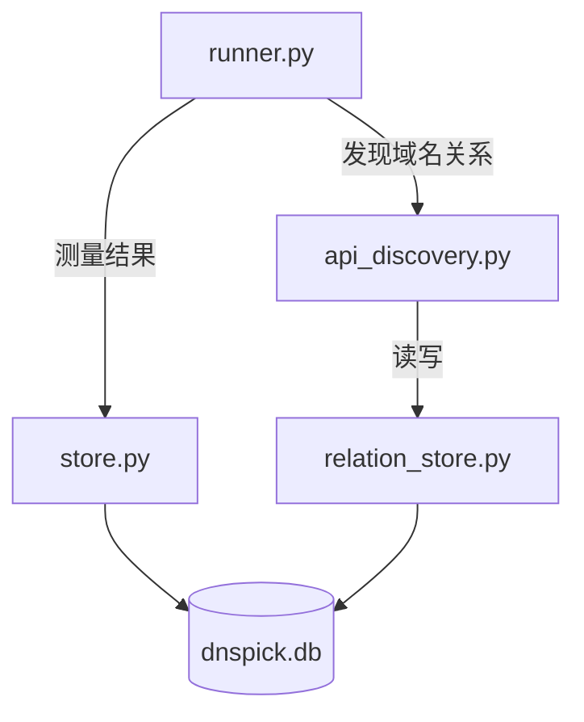

# API 域名自动发现 —— 设计方案

## 概述

在实际上网过程中，访问主域名（如 `www.bilibili.com`）时，浏览器会向多个关联域名发起请求
（如 `api.bilibili.com`、`i0.hdslb.com`）。不同 DNS 对这些 CDN/API 域名的调度差异很大，
只测主域名会严重低估 CDN 调度能力。

本功能自动发现主域名背后的关联 API/CDN 域名，将其纳入 DNS 测量矩阵，综合评估各 DNS 上游
的调度优劣。该功能作为**可选特性**，通过 `Tunables.api_discovery_enabled` 控制启停。

---

## 一、核心思路

### 1.1 两种发现策略

| 策略 | 数据源 | 原理 | 能发现什么 |
|------|-------|------|-----------|
| **HTML 抓取** | 主站首页 HTML | 请求 `https://主域名/`，解析 HTML 提取所有外部域名引用 | JS 脚本、CSS、图片、视频、iframe 等资源域名 |
| **证书透明度** | crt.sh 公开日志 | 查询 `https://crt.sh/?q=%.根域&output=json`，获取所有签发过证书的子域名 | 该根域下的全部 HTTPS 子域名（覆盖面极广） |

### 1.2 相关性定义

**不设白名单/黑名单**。主域名页面引用了什么外部域名，就记录什么。

```
www.bilibili.com 的 HTML 中引用了:
✅ api.bilibili.com      → 记录
✅ i0.hdslb.com          → 记录
✅ s1.hdslb.com          → 记录
✅ cdn.jsdelivr.net      → 记录（公共 CDN，也记录）
✅ www.google-analytics.com → 记录（第三方统计，也记录）
```

公共 CDN（如 `cdn.jsdelivr.net`）会被多个主域名引用。**不去重存储关系**，而是在
**DNS 测量阶段做域名层面的去重**：同一个域名只被每台 DNS 服务器解析一次。

### 1.3 DNS 测量时的去重

```
多个主域名的关联域名集合汇总：
  www.bilibili.com → {api.bilibili.com, i0.hdslb.com, cdn.jsdelivr.net}
  www.taobao.com   → {api.taobao.com, img.alicdn.com, cdn.jsdelivr.net}
  github.com       → {api.github.com, cdn.jsdelivr.net}

去重后待测域名：
  api.bilibili.com, i0.hdslb.com, cdn.jsdelivr.net (只测一次),
  api.taobao.com, img.alicdn.com, api.github.com
```

这样 `cdn.jsdelivr.net` 在每个 DNS 服务器 × 每种协议下只解析一次，不浪费查询。

---

## 二、数据模型

### 2.1 数据库

所有数据存储在 `history/dnspick.db` 中，与现有 `measurement` / `server_score` 表
共库但**逻辑独立**，由独立的 `relation_store.py` 管理。

```sql
CREATE TABLE IF NOT EXISTS domain_relation (
    id              INTEGER PRIMARY KEY AUTOINCREMENT,
    main_domain     TEXT NOT NULL,             -- 主域名，如 "www.bilibili.com"
    related_domain  TEXT NOT NULL,             -- 引用的外部域名，如 "i0.hdslb.com"
    source          TEXT NOT NULL,             -- 来源："html" 或 "crt_sh"
    first_seen_at   TEXT NOT NULL,             -- 首次发现时间，ISO 8601
    last_seen_at    TEXT NOT NULL,             -- 最近确认时间，ISO 8601
    seen_count      INTEGER NOT NULL DEFAULT 1,-- 累计被确认次数
    UNIQUE(main_domain, related_domain, source)
);

CREATE INDEX IF NOT EXISTS idx_dr_main
    ON domain_relation(main_domain);
CREATE INDEX IF NOT EXISTS idx_dr_related
    ON domain_relation(related_domain);
CREATE INDEX IF NOT EXISTS idx_dr_last_seen
    ON domain_relation(main_domain, last_seen_at);
```

**表职责极简**：只回答一个问题 ——「A 域名引用了哪些 B 域名？」。不存 IP、不存评分、
不存测量结果。

### 2.2 代码模块划分

```
src/dnspick/
├── store.py             # measurement + server_score 表  (现有，不动)
├── relation_store.py    # domain_relation 表            (新增，独立模块)
├── api_discovery.py     # 发现逻辑                      (新增)
├── config.py            # Tunables 加开关               (微量修改)
├── runner.py            # 测量前插入发现阶段             (微量修改)
└── scorer.py            # 不动
```

两个 store 模块完全解耦、互不引用、互不依赖。`runner.py` 作为编排层同时调用两者。



---

## 三、发现流程

### 3.1 整体时序

Runner 采用**扁平 9 阶段**架构，API 域名发现在第 3 阶段执行：

```
Runner.run() 启动测量
  │
  ├── 1. 环境探测（公网IP / ECS子网）
  │
  ├── 2. 域名收集（从 DomainStore 加载所有 enabled=1 的域名）
  │
  ├── 3. API 域名发现（如果 api_discovery_enabled = true）
  │   │
  │   for each 已启用主域名 (asyncio.gather 并发):
  │   │
  │   ├── ① 查缓存
  │   │   SELECT * FROM domain_relation
  │   │   WHERE main_domain = 'www.bilibili.com'
  │   │   AND last_seen_at > datetime('now', '-7 days')
  │   │
  │   │   ├─ 有 ≥ 3 条缓存 → 用缓存，跳过发现
  │   │   └─ 缓存不足 → 执行发现
  │   │
  │   ├── ② 策略1：HTML 抓取  (timeout: 5s)
  │   │   GET https://www.bilibili.com/
  │   │   解析 HTML → 提取外部域名集合 A
  │   │   写入 domain_relation（UPSERT）
  │   │
  │   ├── ③ 策略2：证书透明度  (timeout: 8s)
  │   │   GET https://crt.sh/?q=%.bilibili.com&output=json
  │   │   解析 JSON → 提取子域名集合 B
  │   │   写入 domain_relation（UPSERT）
  │   │
  │   └── ④ 合并 A ∪ B，返回域名列表，与已有域名去重后附加
  │
  ├── 4. DNS 解析（N 个域名 × S 台服务器 + 劫持探针）
  ├── 5. ECS 对比（可选，逐个 server 对比）
  ├── 6. TCP 探测（多端口握手，取 p50 延迟）
  ├── 7. ICMP 探测（系统 ping，线程池并发）
  ├── 8. 归属地（GeoIP 批量查询）
  └── 9. 评分（分组打分 + 综合结论）
```

### 3.2 策略 1：HTML 抓取

#### 提取目标

| HTML 标签 / 属性 | 提取内容 | 示例域名 |
|-----------------|---------|---------|
| `<script src="...">` | JS 脚本域名 | `s1.hdslb.com` |
| `<link href="...">` | CSS / 字体 / favicon 域名 | `static.hdslb.com` |
| `` | 图片 CDN 域名 | `i0.hdslb.com` |
| `` | 懒加载图片域名 | `i1.hdslb.com` |
| `<source src="...">` | 视频 / 音频源域名 | `upos-sz-mirrorcos.bilivideo.com` |
| `<iframe src="...">` | 嵌入页面域名 | `player.bilibili.com` |
| `<video src="..." poster="...">` | 视频及封面域名 | — |
| `<audio src="...">` | 音频域名 | — |
| `<meta content="...">` | Open Graph 图片等 | `www.bilibili.com` |
| `url(...)` (CSS) | CSS 背景图/字体 | `i2.hdslb.com` |
| 内联 `https?://...` | JS 中硬编码的 API 地址 | `api.bilibili.com` |
| `//domain.com/...` | protocol-relative URL | `cdn.jsdelivr.net` |

#### 提取规则

1. 用正则从 HTML 属性（`src`, `href`, `data-src`, `content`）及 CSS `url()` 中提取 URL
2. 同时扫描页面中所有 `https?://...` 及 `//...` 形式的内联 URL
3. 从 URL 提取 hostname 后，通过域名校验函数过滤无效结果
4. 去重后返回域名集合

#### 域名校验规则

提取出的 hostname 需通过以下所有校验才算有效域名：

| 校验项 | 规则 | 典型拒绝案例 |
|--------|------|-------------|
| 字符集 | 仅允许 ASCII 字母、数字、`.`、`-` | `中文.com`（包含非 ASCII） |
| TLD | 顶级域必须包含至少一个字母 | `333.1007`（纯数字 TLD） |
| IP 地址 | 排除纯 IPv4（如 `127.0.0.1`）和 IPv6（`::1`） | `192.168.1.1` |
| 保留主机 | 排除 `localhost`, `example.com`, `test.com` 等 | `localhost` |
| 标签格式 | 每个 label 不能以 `-` 开头/结尾 | `-bad.com`, `bad-.com` |
| 连续横线 | 同一 label 内不允许 4 个及以上连续 `-` | `a----b.example.com` |
| 废弃关键词 | 任一 label 等于或 `keyword-` 开头即丢弃 | `staging.api.example.com` |

### 3.3 策略 2：证书透明度

#### API 调用

```
GET https://crt.sh/?q=%.bilibili.com&output=json
```

返回该根域下所有签发过 HTTPS 证书的域名列表。

#### 过滤规则

| 过滤项 | 原因 |
|--------|------|
| 通配符域名 `*.bilibili.com` | 去掉前导通配符 `*.`，保留根域 `bilibili.com` |
| 重复条目 | crt.sh 返回同一域名的多张证书记录，自动去重 |
| 废弃关键词 | 按 label 精确匹配或 `keyword-` 前缀匹配，详见下表 |
| 超过 60 条 | 防止单次查询返回过多数据 |

**废弃关键词列表**（命中即丢弃）：

| 关键词 | 匹配示例 | 不匹配示例 |
|--------|---------|-----------|
| `test` | `test.bilibili.com`, `test-api.bilibili.com` | `latest.bilibili.com` |
| `old` | `old.example.com`, `old-cdn.example.com` | `gold.example.com` |
| `deleted` | `deleted.service.com` | — |
| `staging` | `staging.example.com`, `staging-api.example.com` | — |
| `dev` | `dev.myapp.com`, `dev-api.myapp.com` | `developer.myapp.com` |
| `demo` | `demo.site.com` | — |
| `tmp` | `tmp-files.example.com` | — |
| `temp` | `temp.example.com`, `temp-cdn.example.com` | `template.example.com` |
| `deprecated` | `deprecated.api.com` | — |

> 匹配逻辑：将域名按 `.` 拆分为 labels，任一 label 等于 keyword 或以 `keyword-` 开头即丢弃。 |

### 3.4 缓存策略

| 条件 | 行为 |
|------|------|
| 7 天内有缓存 且 ≥ 3 条关系 | 跳过发现，直接用缓存 |
| 缓存不足或过期 | 重新执行发现 |
| 发现过程中某一策略失败 | 静默跳过该策略，使用成功的策略结果 + DB 缓存 |
| 发现阶段整体超时（30 秒） | 取 DB 中已有缓存返回，不阻塞主流程 |

---

## 四、配置项

在 `Tunables` 中增加以下字段：

```python
@dataclass
class Tunables:
    # ... 现有字段保持不变 ...

    # ── API 域名发现 ──
    api_discovery_enabled: bool = False        # 总开关，默认关闭
    api_discovery_cache_days: int = 7          # 缓存有效期（天）
    api_discovery_html_timeout: float = 5.0    # HTML 抓取超时（秒）
    api_discovery_crt_timeout: float = 8.0     # crt.sh 查询超时（秒）
    api_discovery_max_per_source: int = 60     # 每种策略最多取多少域名
    api_discovery_min_cache: int = 3           # 至少有 N 条缓存才跳过发现
```

这些字段参与 `save()` / `load_saved()` 的持久化流程，也参与 `Config.to_dict()` 以便 GUI 读取。

---

## 五、评分集成

### 5.1 分组规则

关联域名**继承其主域名的 Group**：

```
www.bilibili.com  (Group.CN)
├─ api.bilibili.com    → 归入 CN 组评分
├─ i0.hdslb.com        → 归入 CN 组评分
└─ cdn.jsdelivr.net    → 归入 CN 组评分（首次引用的主域名决定）

www.google.com  (Group.GLOBAL)
├─ www.gstatic.com     → 归入 GLOBAL 组评分
└─ cdn.jsdelivr.net    → 已在 CN 组，不重复添加
```

跨组公共域名（同时被 CN 和 GLOBAL 主域名引用）→ 归入首次出现的主域名的 Group。
这个决定对评分的影响可忽略（权重被均摊到组内所有域名）。

### 5.2 权重计算

关联域名在评分中权重与主域名一致：

```
对某台 DNS 服务器的 CN 组评分：
  组内总域名数 = 原始 CN 域名数 + 去重后关联域名数

  cdn.jsdelivr.net 的权重 = 1 / 组内总域名数

如果 CN 组有 30 个域名（含关联域名），它占 ~3.3%
—— 权重很小，不会扭曲结果，但被纳入了考量
```

### 5.3 对现有代码的影响范围

`scorer.py` **不需要任何修改**。关联域名在进入 DNS 解析之前已经被赋予正确的 `Group`，
作为 `DomainSpec` 传入，后续评分流程完全不变。

---

## 六、Runner 集成点

`runner.py` 在扁平阶段序列的第 3 步执行 API 发现：

```python
class Runner:
    def __init__(self, config: Config, domain_store: DomainStore, ...):
        self.cfg = config
        self.dom_store = domain_store

    async def run(self) -> RunResult:
        # 阶段 1: 环境探测
        self._enter_stage("环境探测")
        public_ip = await self._detect_public_ip()
        ecs = _to_subnet(public_ip) if public_ip and self.cfg.use_ecs else None

        # 阶段 2: 域名收集
        self._enter_stage("域名收集")
        domains = self.dom_store.get_enabled()

        # 阶段 3: API 域名发现（可选）
        if self.cfg.tunables.api_discovery_enabled:
            self._enter_stage("API发现")
            discovery = ApiDomainDiscovery(...)
            related_map = await discovery.discover_all(
                [d.name for d in domains]
            )
            extra = ApiDomainDiscovery.to_domain_specs(related_map, domains)
            domains.extend(extra)
        else:
            self._skip_stage("API发现")

        # 阶段 4: DNS 解析
        self._enter_stage("DNS 解析")
        records = await self._resolve(domains, servers, ecs)
        # ... 后续阶段 ...
```

---

## 七、错误处理

| 场景 | 处理方式 |
|------|---------|
| HTML 抓取超时 | 静默跳过，使用 crt.sh 结果 + DB 缓存 |
| crt.sh 查询超时 | 静默跳过，使用 HTML 结果 + DB 缓存 |
| crt.sh 返回 429（限频） | 等待 2 秒重试一次，仍失败则跳过 |
| 两个策略都失败 | 使用 DB 中已有缓存（无视过期时间） |
| DB 写入失败 | 仅记录日志，不影响测量流程 |
| 发现阶段总耗时超过 30 秒 | 终止发现，取已有缓存运行 |
| 所有策略 + 缓存都无数据 | 不添加额外域名，仅测原始域名列表 |

---

## 八、文件改动清单

| 文件 | 改动量 | 说明 | 状态 |
|------|--------|------|------|
| `src/dnspick/api_discovery.py` | **新增** ~410行 | HTML抓取 + crt.sh 查询 + 域名校验 + DomainSpec 生成 | ✓ 已实现 |
| `src/dnspick/relation_store.py` | **新增** ~180行 | domain_relation 表的建表、CRUD、缓存查询、正反向查找 | ✓ 已实现 |
| `src/dnspick/domain_store.py` | **新增** ~200行 | domain 主表管理，域名统一存储（种子、自定义、历史） | ✓ 已实现 |
| `src/dnspick/config.py` | **已修改** | Tunables 加 6 个配置项；域名不再由 Config 管理 | ✓ 已实现 |
| `src/dnspick/runner.py` | **已修改** | 扁平9阶段序列；API发现在阶段3执行；接入 DomainStore | ✓ 已实现 |
| `src/dnspick/scorer.py` | **不动** | 关联域名已带正确 Group，自动参与评分 | — |
| `src/dnspick/store.py` | **不动** | 完全独立 | — |
| `src/dnspick/models.py` | **已修改** | DomainSpec 已移除 tier 字段 | ✓ 已实现 |
| `tests/test_api_discovery.py` | **新增** ~265行 | 24 个单元测试 | ✓ 已实现 |
| `scripts/discover_bilibili.py` | **新增** ~100行 | 真实网络测试脚本 | ✓ 已实现 |

**总计：已全部实现。**

---

## 九、安全性考量

- HTML 抓取和 crt.sh 查询均为**只读操作**，不发送任何用户数据
- 不存储 HTML 源码、cookies、请求头等任何可能含隐私的数据
- 数据库仅存域名关系（两列字符串 + 时间戳），不含个人信息
- 所有外部 HTTP 请求设置严格的超时限制，防止网络问题阻塞主流程
- crt.sh 查询使用公共 API，无需 API Key